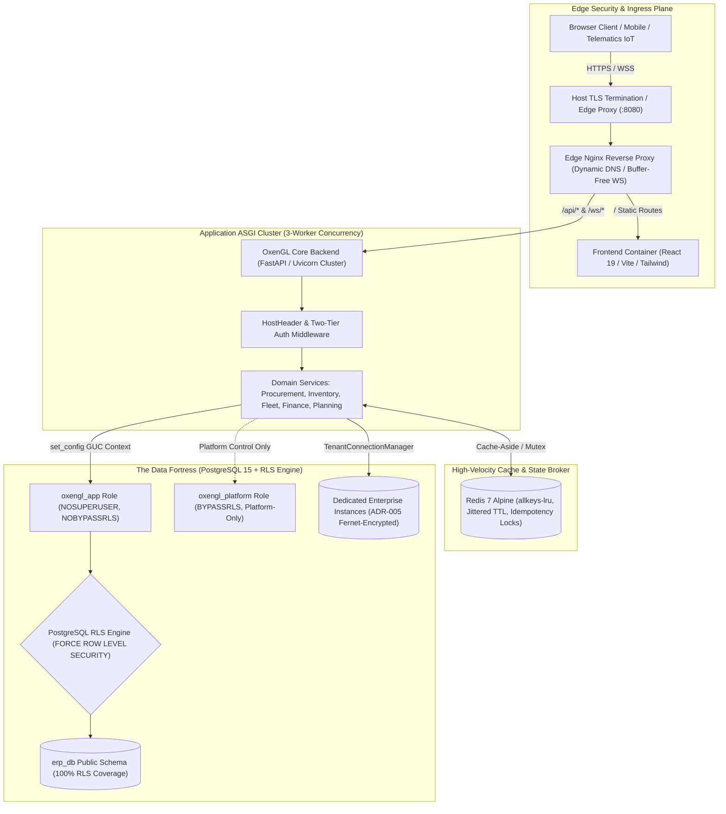
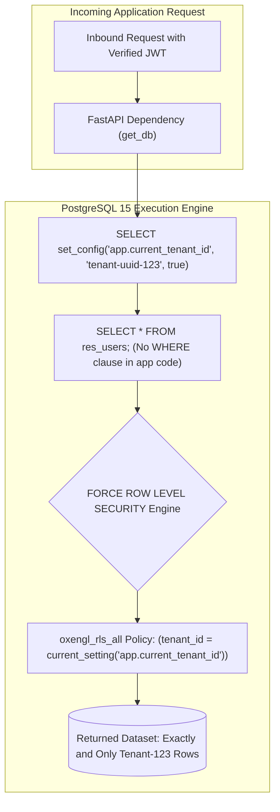
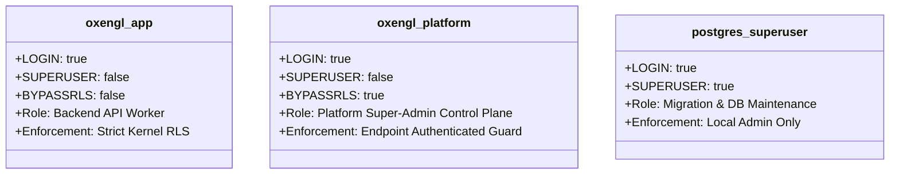
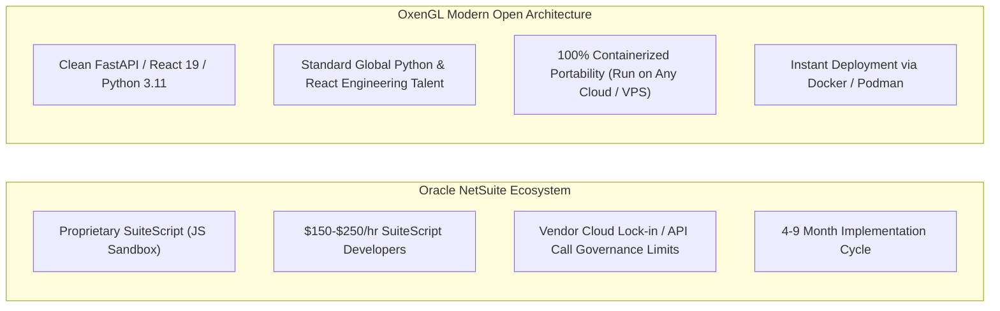

# OxenGL Master Technical & Architectural Manifesto

**Classification:** Enterprise Strategic Technical Architecture & Market Positioning  
**Target Audience:** Technical Founders · Chief Operating Officers (COOs) · Chief Information Security Officers (CISOs) · Enterprise IT Directors  
**Version:** 2026.1  
**Audit Baseline:** Forensic codebase audit, PostgreSQL 15 schema verification, and containerized runtime analysis.

---

## Executive Summary & Architectural Thesis

The enterprise software market in 2026 faces an efficiency and architectural crisis. Global legacy ERP monoliths—Oracle NetSuite, SAP S/4HANA, and modular mid-market platforms like Odoo—continue to extract exorbitant licensing rents while locking enterprises into brittle, proprietary languages (SuiteScript, ABAP) and sluggish 4-to-18-month deployment cycles. More critically, their data isolation architectures frequently rely on fragile application-layer filters (`WHERE tenant_id = ...`) that fail silently under custom SQL joins, ORM edge cases, or API vulnerabilities.

**OxenGL** is an industrial-grade, cloud-native ERP platform built from the ground up for high-velocity supply chains, complex logistics, and multi-tenant SaaS operations. Engineered on a modern Python (FastAPI/SQLAlchemy) and React 19/TypeScript architecture, OxenGL enforces **100% Row-Level Security (RLS) directly inside the PostgreSQL database engine**. Tenant boundaries are not software conventions; they are kernel-level mathematical guarantees.

By pairing database-enforced multi-tenancy with a containerized 5-service footprint that operates reliably within a 2GB RAM envelope, native ZATCA Phase 2 cryptographic e-invoicing, Saudi TGA WASL fleet telematics compliance, and zero-downtime staged deployment automation, OxenGL establishes a new benchmark for capital-efficient, high-security enterprise resource planning.



---

## Section 1: The OxenGL Identity & True Capabilities

### 1.1 Technical Stack & System Topography

OxenGL is engineered as a lean, containerized micro-service stack designed to deliver sub-second response times and continuous operational availability on commodity VPS infrastructure (e.g., 2GB RAM Vultr, Hostinger, or AWS EC2 instances).

| Component | Technology | Implementation Detail | Repository Evidence |
|---|---|---|---|
| **Frontend SPA** | React 19, TypeScript 5.8, Vite 6 | Lucide icons, TailwindCSS, Recharts, i18next bilingual (Arabic RTL / English LTR) | `frontend/package.json`, `frontend/src/` |
| **API Application Server** | FastAPI, Uvicorn ASGI | Multi-worker concurrency (`--workers 3`), Starlette middleware pipeline | `docker-compose.yml`, `backend/Dockerfile` |
| **Persistence Layer** | SQLAlchemy 2.0 (psycopg2) | Synchronous transactional connection pools, dynamic GUC context injection | `backend/database.py`, `backend/models.py` |
| **Database Engine** | PostgreSQL 15 + pgvector | 100% public table RLS, vector embeddings for AI document RAG | `docker-compose.yml`, `backend/enforce_erp_db_rls.sql` |
| **Caching & In-Flight Locks** | Redis 7 Alpine | LRU eviction (`maxmemory 64mb`), jittered TTL, 24-hr transaction idempotency | `backend/app/core/cache.py`, `docker-compose.yml` |
| **Reverse Proxy / Edge** | Nginx Alpine | Podman/Docker dynamic resolver (`valid=10s`), bufferless WebSocket streaming | `nginx.conf`, `frontend/nginx.conf` |
| **Database Migrations** | Alembic | 73 ordered migrations tracking schema evolution from v1 to live head | `backend/alembic/versions/` |
| **CI/CD Security Gates** | GitHub Actions | Architecture validation, two-tier auth enforcement, zero-downtime deploy hooks | `.github/workflows/saas-ci-cd.yml` |

### 1.2 Full Data Flow: React → FastAPI → Redis → PostgreSQL

Every transaction inside OxenGL traverses a strictly guarded 5-stage pipeline:

1. **Edge Routing & Ingress:** Requests hit the Edge Nginx reverse proxy on port 8080. Nginx performs path-based dispatch:
   - Root `/` and static assets route to the static SPA container (`frontend/nginx.conf`).
   - `/api/` endpoints route to the FastAPI ASGI cluster.
   - `/api/v1/logistics/ws` routes with `proxy_buffering off` and extended 24-hour read/send timeouts to support continuous telematics ingestion.
   - PWA service workers (`sw.js`) and `index.html` are forced to `Cache-Control: no-cache, no-store, must-revalidate` to prevent stale application shells.
2. **Tenant Domain Resolution:** `HostHeaderMiddleware` inspects incoming `Host` headers. It prioritizes registered custom domains (`CustomDomain`), checks `*.oxengl.me` subdomains, and falls back to URL path slugs. The resolved tenant company ID and slug are permanently bound to `request.state.tenant_company_id` and emitted in downstream response headers (`X-Resolved-Tenant`).
3. **Cryptographic Identity Validation:** The request passes through the `two_tier_auth` guard. Authorization headers and session cookies are decrypted. Inbound JWTs are strictly validated against their target tier secret (`JWT_SECRET_MASTER` vs `JWT_SECRET_TENANT`) and audience claim (`oxengl-master-portal` vs `oxengl-erp-app`). Callers attempting to spoof tenant IDs via HTTP headers (`X-Tenant-ID`, `X-Company-ID`) are stripped and overridden by the verified token claims.
4. **Cache-Aside & Concurrency Serialization:** Before executing expensive queries, the application queries Redis using namespaced keys (`oxengl:{env}:{tenant_id}:{domain}:{resource}:{identifier}:{version}`). Cache TTLs are jittered by ±10–20% to prevent cache stampedes. State-mutating operations acquire a 30-second in-flight distributed lock with a 24-hour idempotency key, preventing duplicate invoice postings or double-spend journal entries.
5. **Database Context Injection & RLS Filtering:** The database session generator (`backend/database.py:get_db`) initializes the connection. It executes:
   ```sql
   SELECT set_config('app.current_tenant_id', :tenant_id, true),
          set_config('app.current_company_id', :company_id, true);
   ```
   The third parameter (`is_local = true`) scopes the Grand Unified Configuration (GUC) parameter strictly to the active transaction. When the connection returns to the connection pool, the context is automatically dropped. PostgreSQL's RLS engine uses this setting to filter all read, insert, update, and delete queries.

### 1.3 Containerized Concurrency & Zero-Downtime Staged Reloads

OxenGL resolves the traditional 502 Bad Gateway deployment bottleneck through a synchronized combination of ASGI concurrency, container health checks, and staged process reloads:

- **Uvicorn Concurrency Scaling:** Rather than running as a single-threaded process, the backend container boots with `--workers 3` and `--limit-concurrency 100` (`docker-compose.yml:89`). This worker pool provides optimal parallel request handling for multi-core VPS deployments while staying strictly within a 512MB memory boundary.
- **Python Built-in Health Checks:** Containers do not depend on external utilities like `curl` that may be stripped from hardened minimal Alpine/Debian base images. The backend defines an in-process health probe:
  ```yaml
  healthcheck:
    test: ["CMD", "python", "-c", "import urllib.request; urllib.request.urlopen('http://localhost:8000/api/v1/health')"]
    interval: 30s
    timeout: 10s
    retries: 3
  ```
- **Staged Zero-Downtime Reload Execution (`deploy.sh`):**
  Redeployments do not take down the entire network stack simultaneously. Instead, the deployment script executes a phased handoff:
  ```bash
  # 1. Rebuild new images in the background
  docker-compose build backend frontend
  # 2. Recreate backend container without disrupting edge Nginx or database
  docker-compose up -d --no-deps backend
  # 3. Allow Uvicorn worker pool to warm and pass initial health check
  sleep 5
  # 4. Gracefully reload Nginx configuration to flush upstream socket caches
  docker exec oxengl_nginx_container nginx -s reload
  ```
  Coupled with Nginx's internal dynamic resolver (`valid=10s`), existing client TCP connections remain uninterrupted, and new requests are seamlessly routed to the freshly initialized backend workers.

---

### 1.4 Comprehensive Module Deep-Dive

Every module documented below is extracted directly from the verified SQLAlchemy data models (`backend/models.py`, `backend/app/domains/*`) and FastAPI API routers (`backend/app/api/v1/*`):

#### 1. Procurement & Competitive E-Tendering (`domains/procurement`)
- **End-to-End Purchase-to-Pay:** Covers Purchase Requisitions (`purchase_requisitions`, `purchase_requisition_lines`), Request for Quotations (RFQs), Purchase Orders (`purchase_orders`, `purchase_order_lines`), Goods Receipts with batch inspection logs (`goods_receipts`, `goods_receipt_batch_logs`), and 3-Way Match Vendor Invoices (`vendor_bills`).
- **Configurable Multi-Tier Approval Matrix:** Workflows are orchestrated via `approval_rules`, `workflow_instances`, and `workflow_steps`. Requisitions route through sequential approval hierarchies based on total value, departmental budgets, and user authority levels.
- **Cryptographic Sealed-Bid E-Tendering:** The tendering engine (`procurement_tenders`, `tender_rfq_lines`, `procurement_bids`, `procurement_bid_lines`) allows enterprises to publish public or private tenders. Bids submitted by vendors remain cryptographically locked and sealed until the official closing date. The system provides an automated unsealing ceremony endpoint (`/approvals/tenders/{id}/unseal`) that unlocks bid prices simultaneously, preventing insider price leaking.
- **Dedicated Supplier Vendor Portal:** External suppliers access a quarantined vendor workspace (`vendor_portal_users`) allowing them to register, review active RFQs, submit sealed bids, upload compliance documentation, and track payment disbursements without accessing internal ERP records.
- **Weighbridge & Bulk Ingestion Ticketing:** Dedicated support for bulk agricultural and raw materials logistics via `weighbridge_tickets`. Captures gross vehicle weight, tare weight, net material weight, and automatically calculates quality deductions (moisture %, impurities %, foreign matter) before generating inventory goods receipts.

#### 2. Global Inventory, Landed Cost & Valuation (`domains/inventory`)
- **Multi-Warehouse & Stock Movements:** Multi-facility tracking across central warehouses, transit hubs, and retail outlets (`materials`, `warehouses`, `stock_moves`, `stock_balances`).
- **Automated Landed Cost Allocation Engine:** Solves the primary accounting challenge of global supply chains via `landed_cost_allocations` and `landed_cost_items`, processed by a background worker (`services/landed_cost_worker.py`). Customs duties, international ocean freight, port handling charges, and transit insurance are amortized and capitalized directly into inventory unit costs using FIFO or weighted apportionment.
- **Real-Time Valuation Engine:** `services/valuation_agent.py` provides automated inventory valuation recalculations supporting FIFO, Moving Average, and Standard Costing conventions.
- **Multi-Currency Engine:** Handles international procurement with base currency conversion (USD, SAR, YER), dynamic exchange rate synchronization (`oxengl_exchange_rates`), and transactional realized/unrealized FX gain and loss calculations.

#### 3. Logistics, Fleet Telematics & Customs Compliance (`domains/logistics`)
- **Fleet Asset Tracking & Telematics:** Comprehensive driver management (`drivers`), vehicle tracking (`vehicles`), scheduled preventative maintenance, fuel consumption logs, and digital waybills (`waybills`).
- **Multi-Drop Delivery Manifests:** Supports complex multi-stop distribution logistics via `delivery_manifests` and ordered `manifest_stops`, tracking delivery sequences, recipient signatures, and delivery status timestamps.
- **IoT Sensor Telematics & Live WebSockets:** Integrates hardware GPS telematics via Teltonika device listeners. Ingests real-time IoT telemetry events (refrigerated cold-chain cargo temperatures, shock sensors, door-open alerts, route deviations) and broadcasts live vehicle positions via WebSockets (`/api/v1/logistics/ws` and `/ws/fleet-stream`).
- **Saudi TGA WASL API Compliance:** Native client and queue worker integrated with the Saudi Transport General Authority (WASL platform). Automatically validates driver identity, vehicle registration, and pushes mandatory trip tracking events to national transport databases.
- **Customs Manifest Workflow:** Customs clearance tracking (`customs_manifests`, `customs_declarations`), HS code categorization, tariff calculations, and port authority clearance stage verification.

#### 4. Finance, Double-Entry General Ledger & ZATCA Phase 2 (`domains/finance`)
- **Immutable Double-Entry Bookkeeping:** Chart of Accounts (`accounts`), Journal Vouchers (`journal_entries`), and debit/credit ledger lines (`journal_lines`). System-level database triggers and API constraints strictly enforce the accounting invariant: $\sum \text{Debits} = \sum \text{Credits}$ before posting.
- **ZATCA Phase 2 E-Invoicing Engine:** Complete native Saudi tax authority compliance via `zatca_adapter.py`:
  - Generates Universal Business Language (UBL 2.1) compliant XML invoices.
  - Generates cryptographic ECDSA signatures using the `secp256k1` curve.
  - Implements SHA-256 invoice hashing and invoice counter value chaining.
  - Encodes mandatory Tag-Length-Value (TLV) base64 QR codes containing seller name, VAT registration number, invoice timestamp, total amount, and VAT tax sum.
- **Customer Billing & Payment Orchestration:** Invoicing, credit memos, shared public invoice verification links (`/shared/invoice/:token`), and integration with regional and international payment gateways (Moyasar for Mada/Visa/Mastercard, Stripe, and Paddle webhooks).

#### 5. Planning Department & Cryptographic Ledger (`domains/planning`)
- **Project Charters & Work Breakdown Structure (WBS):** Formal governance framework managing enterprise programs via `project_charters`.
- **Execution Matrix Table:** Granular task decomposition (`execution_tasks`) with dependency tracking, milestone deadlines, batch task generation, and completion velocity metrics.
- **Strategic Hazard & Risk Tracker:** Integrated operational risk management via `strategic_hazards`. Hazards attach directly to execution tasks, scoring probability and business impact, and providing formal mitigation sign-off workflows (`/hazards/{id}/mitigate`). Charters dynamically calculate and report `active_hazards_count` to prevent project closeout while critical risks remain unmitigated.
- **Cryptographic Electronic Ledger Blocks:** Tamper-evident tracking for mission-critical supply-chain milestones via `electronic_ledger_blocks`. Blocks are sequentially linked using SHA-256 cryptographic hashes, guaranteeing an immutable audit trail of major project state changes.

#### 6. Human Resources & Automated IAM Provisioning (`domains/hr`)
- **Comprehensive HRMS Core:** Employee lifecycle management (`employees`), document storage with automated expiry notifications (Iqamas, passports, commercial registrations), biometric attendance logs, leave management, and payroll processing runs.
- **HR-to-IAM Automated Provisioning:** `iam/provisioning.py` bridges human resources with identity access management. Creating or updating an employee record automatically provisions or modifies their system user account (`res_users`), binding them to predefined role templates (`role_catalog.py`).
- **Append-Only Audit Trail:** Dedicated immutable logging (`hr/audit.py`) tracking all salary revisions, contract modifications, and disciplinary actions.

#### 7. AI Knowledge Retrieval & Predictive Analytics (`domains/ai`, `app/agent`)
- **Tenant-Isolated Vector RAG:** Leverages PostgreSQL's `pgvector` extension to store and search document chunks and enterprise knowledge bases (`knowledge_documents`, `knowledge_chunks`). Every vector similarity search query enforces tenant boundaries, preventing proprietary corporate knowledge from leaking across tenants.
- **Predictive Analytics:** Forecasting services calculate inventory stockout probabilities, demand spikes, and logistics transit delays based on historical operational time-series data.

#### 8. Dynamic Metadata-Driven Forms & UI Engine
- **Zero-Migration Field Customization:** Tenant administrators configure custom business fields via `/api/v1/tenant/form-schemas` across 11 core entity types (text, numbers, dates, booleans, and dropdown options).
- **Storage in JSONB:** Custom attributes are persisted in a native PostgreSQL JSONB column (`custom_attributes`), eliminating the need for dynamic schema migrations (`ALTER TABLE`) that cause database locks.
- **Dynamic Frontend Rendering:** The frontend component `DynamicFieldRenderer.tsx` dynamically consumes the tenant's schema and renders localized, validated form controls inside shared CRUD modals (`EntityCRUDModal.tsx`, `DailyOperationsModal.tsx`).
- **Dynamic Tenant Branding:** White-label capabilities allowing tenants to customize application logos, brand color schemes, and portal titles via `useDynamicBranding` and `BrandingSettingsCard`.

---

## Section 2: The Multi-Tenant Security Paradigm

### 2.1 The Architectural Isolation Imperative

Multi-tenant enterprise SaaS applications historically adopt one of three isolation models:
1. **Database-per-Tenant:** Maximum physical isolation, but suffers from unsustainable operational overhead, connection pool exhaustion, and complex schema migration sprawl when scaling past hundreds of tenants.
2. **Application-Layer Filtering (The Standard Approach):** Tenants share a database and schema. Every developer query must manually append `WHERE tenant_id = current_tenant`. This model is notoriously fragile. A single junior developer writing a raw SQL query, an unvetted ORM relationship join, or an unauthenticated report endpoint exposes all enterprise tenants to catastrophic cross-tenant data leaks (OWASP Top 10 A01: Broken Access Control).
3. **OxenGL's Kernel-Level Enforcement (PostgreSQL RLS):** Tenants share a high-performance database and schema, but data isolation is enforced **inside the database engine itself** using PostgreSQL Row-Level Security.

In OxenGL, if an application developer writes `SELECT * FROM res_users;` or `SELECT * FROM invoices;` without a `WHERE` clause, the PostgreSQL engine automatically and invisibly applies the security policy, returning **only** rows belonging to the authenticated tenant. Application bugs result in empty query sets, never data breaches.



### 2.2 Deep Dive into `enforce_erp_db_rls.sql`

Database security in OxenGL is governed by `backend/enforce_erp_db_rls.sql`, an industrial-grade PL/pgSQL orchestration script executed during database provisioning and post-migration hardening:

#### 1. Dynamic Table Discovery and 100% Coverage
The script iterates across all user tables and partitioned tables in the `public` schema:
```sql
FOR table_row IN
    SELECT c.oid, c.relname,
           bool_or(a.attname = 'tenant_id') AS has_tenant_id,
           bool_or(a.attname = 'company_id') AS has_company_id
    FROM pg_class c
    JOIN pg_namespace n ON n.oid = c.relnamespace
    LEFT JOIN pg_attribute a
      ON a.attrelid = c.oid AND a.attnum > 0 AND NOT a.attisdropped
    WHERE n.nspname = 'public' AND c.relkind IN ('r', 'p')
    GROUP BY c.oid, c.relname
    ORDER BY c.relname
LOOP
    ...
```

#### 2. Automatic Predicate Generation
- **Dual-Scoped Tables:** Tables carrying both `tenant_id` and `company_id` enforce:
  ```sql
  tenant_id::text = NULLIF(current_setting('app.current_tenant_id', true), '') 
  AND (company_id IS NULL OR company_id::text = NULLIF(current_setting('app.current_tenant_id', true), ''))
  ```
- **Single-Scoped Tables:** Tables carrying either `tenant_id` or `company_id` match directly against the transaction GUC.
- **Relational Child Tables:** Tables lacking direct scoping columns enforce isolation through parent table `EXISTS` subqueries:
  - `journal_lines`: Validates parent `journal_entries` **and** linked `accounts`.
  - `landed_cost_items`: Validates parent `landed_cost_allocations` **and** linked `materials`.
  - `manifest_stops`: Validates parent `delivery_manifests` **and** linked `waybills`.
  - `goods_receipt_batch_logs`: Validates parent `goods_receipts`.
  - `purchase_order_lines`: Validates parent `purchase_orders`.
  - `purchase_requisition_lines`: Validates parent `purchase_requisitions`.
  - `tender_rfq_lines`, `procurement_bids`, `procurement_bid_lines`: Validate parent `procurement_tenders`.
  - `workflow_steps`: Validates parent `workflow_instances`.
  - `refresh_tokens`, `security_tokens`: Validate parent user sessions and users.
- **Shared Reference Tables:** Tables such as `subscription_plans`, `oxengl_currencies`, `oxengl_exchange_rates`, and `sso_providers` grant read access to active rows (`is_active IS TRUE`), while restricting write operations (`INSERT`, `UPDATE`, `DELETE`) exclusively to the platform control plane.
- **Platform Control Plane Tables:** Control-plane entities (`master_users`, `master_tenants`, `master_audit_logs`, `platform_settings`, `site_settings`, `alembic_version`) enforce:
  ```sql
  current_user = 'oxengl_platform'
  ```

#### 3. Fail-Closed Safety Valve
If a migration creates a new table that lacks `tenant_id` or `company_id` and has not been explicitly mapped in the `CASE` statement, the script terminates immediately:
```sql
ELSE
    RAISE EXCEPTION 'No tenant or control-plane policy mapping for public.%', table_row.relname;
END CASE;
```
It is impossible to deploy a database change that accidentally exposes unscoped data.

#### 4. Mandatory Table-Level Enforcement
For every single table, the script executes:
```sql
EXECUTE format('ALTER TABLE public.%I ENABLE ROW LEVEL SECURITY', table_row.relname);
EXECUTE format('ALTER TABLE public.%I FORCE ROW LEVEL SECURITY', table_row.relname);
```
`FORCE ROW LEVEL SECURITY` is critical: in standard PostgreSQL, table owners bypass RLS policies by default. `FORCE` strips this exemption, ensuring that even backend background jobs or migrations executing as table owners are strictly contained within tenant boundaries.

#### 5. Verification Assertion
At completion, the script counts all enabled, forced, and policied tables against total public tables:
```sql
SELECT count(DISTINCT c.oid) INTO covered_count
FROM pg_class c
JOIN pg_namespace n ON n.oid = c.relnamespace
JOIN pg_policies p ON p.schemaname = n.nspname AND p.tablename = c.relname
WHERE n.nspname = 'public' AND c.relkind IN ('r', 'p')
  AND c.relrowsecurity AND c.relforcerowsecurity;

IF covered_count <> table_count THEN
    RAISE EXCEPTION 'RLS coverage mismatch: % tables, % enabled/forced with policies',
        table_count, covered_count;
END IF;
```

### 2.3 Least-Privilege Database Role Architecture

OxenGL decouples application execution from database administration through two distinct database logins:



1. **`oxengl_app` (Application API Role):**
   - Attributes: `NOSUPERUSER NOBYPASSRLS NOINHERIT`.
   - Used by the FastAPI ASGI cluster for all standard business operations.
   - Because `NOBYPASSRLS` is set, PostgreSQL forcibly applies RLS filters to every query. Even if an attacker executes arbitrary SQL injection through a vulnerable query parameter, the database kernel refuses to return or modify rows outside the active GUC tenant context.
2. **`oxengl_platform` (Platform Management Role):**
   - Attributes: `NOSUPERUSER BYPASSRLS NOINHERIT`.
   - Used strictly by platform super-administrators for cross-tenant operations (tenant onboarding, tenant suspension, billing aggregation, system broadcasts).
   - Guarded at the application layer by `backend/database.py:get_platform_db`, which explicitly requires a verified `master` tier JWT and authorization check. The application role `oxengl_app` has no grant to `SET ROLE oxengl_platform`.

### 2.4 Enterprise Data Residency & Dedicated Database Routing (ADR-005)

For regulated enterprise customers (government logistics, pharmaceutical supply chains, defense contractors) whose data cannot share physical storage with other tenants, OxenGL implements **Enterprise Data Residency (ADR-005)**:

- **Dynamic Connection Router (`TenantConnectionManager`):** Located in `backend/database.py:387`. When an incoming request resolves an enterprise tenant, the connection manager checks its internal engine cache.
- **Dedicated Physical Instances:** If a dedicated database is configured for that `company_id`, `TenantConnectionManager` dynamically provisions a dedicated SQLAlchemy engine and session pool routed to an isolated physical database server.
- **At-Rest Connection String Encryption:** Dedicated database URLs are never stored in plaintext. They are encrypted using Fernet AES-256 symmetric encryption, derived from a mandatory environment secret (`DATA_RESIDENCY_KEY`):
  ```python
  def _get_encryption_fernet(secret_key: str | None = None) -> Fernet:
      raw_key = secret_key or DATA_RESIDENCY_KEY
      derived_32 = hashlib.sha256(raw_key.encode("utf-8")).digest()
      return Fernet(base64.urlsafe_b64encode(derived_32))
  ```
  The system refuses to boot if `DATA_RESIDENCY_KEY` is missing or insecure.

### 2.5 Two-Tier Cryptographic Identity Separation

Identity in OxenGL is divided into two mathematically decoupled security tiers (`backend/two_tier_auth.py`):

| Security Property | Master Control Plane Tier | Tenant ERP Workspace Tier |
|---|---|---|
| **User Identity Model** | `MasterUser` (Platform Operators) | `ResUser` (Tenant Employees & Admins) |
| **Signing Secret** | `JWT_SECRET_MASTER` (Separate 64-char key) | `JWT_SECRET_TENANT` (Separate 64-char key) |
| **Audience Claim (`aud`)** | `oxengl-master-portal` | `oxengl-erp-app` |
| **Password Hashing** | Argon2id (`time_cost=3`, `memory_cost=64MB`) | Argon2id (`time_cost=3`, `memory_cost=64MB`) |
| **Portal Path** | `/admin` | `/tenant/login` (or tenant custom subdomain) |
| **MFA / 2FA** | Mandatory TOTP with handshake tokens | Optional / Configurable per tenant policy |
| **Session Tracking** | Platform audit logs (`master_audit_logs`) | User session table (`user_sessions`) |

Cross-tier token replay is impossible. If a compromised tenant token is presented to a platform management endpoint, the cryptographic signature check fails immediately due to mismatched secrets and audience claims. The React frontend (`ProtectedRoute.tsx`) similarly validates the `tier` claim and renders an access violation screen if a user attempts cross-tier navigation.

---

## Section 3: Global SaaS ERP Battlefield (The "Standalone" Edge)

Enterprise buyers evaluating ERP replacements in 2026 must weigh architectural agility, total cost of ownership (TCO), and implementation risk. Below is an unvarnished forensic comparison between OxenGL, Oracle NetSuite, SAP S/4HANA, and Odoo Enterprise.

### 3.1 2026 Enterprise ERP Benchmark Matrix

| Dimension | OxenGL (2026) | Oracle NetSuite | SAP S/4HANA | Odoo Enterprise |
|---|---|---|---|---|
| **Core Architecture** | Cloud-Native Decoupled (FastAPI + React 19 + PostgreSQL 15) | Proprietary Multi-Tenant Cloud Monolith | Heavy Distributed Monolith (ABAP on HANA) | Monolithic Python (Werkzeug/ORM) + OWL JS |
| **Tenant Isolation Engine** | **Kernel-Level PostgreSQL FORCE RLS** on 100% of tables | Shared database with vendor-managed application filtering | Physical client separation / separate schema / private instances | Application-layer domain filters (`ir.rule`) or separate databases |
| **Customization Language** | Standard Python / TypeScript / Alembic / Dynamic JSONB Schemas | **SuiteScript** (Proprietary JavaScript sandbox) | **ABAP** / SAP Business Technology Platform (BTP) | Python + Odoo Studio (Proprietary XML/ORM) |
| **Typical Deployment Timeline** | **1 to 3 weeks** (Instant container provisioning) | 4 to 9 months (Standard) / 12+ months (Multi-subsidiary) | 9 to 18 months (Standard) / 24+ months (Global) | 2 to 6 months |
| **Year 1 Implementation Cost** | **$0 Vendor License** (Self-hosted or managed container fee) | $45,000 – $200,000+ (Licensing + Mandatory Implementation) | $250,000 – $1,500,000+ (Elite Systems Integrators) | $25,000 – $100,000+ (App bundles + Implementation) |
| **Per-User Licensing Tax** | **$0 / Unlimited Users** | $99 – $250 / user / month + base module fees | $150 – $400+ / user / month + FUE licensing | $9 – $24 / user / month (Scales aggressively with apps) |
| **Infrastructure Envelope** | **Runs in 2GB RAM** (5 lightweight containers) | Multi-tenant SaaS only (Hosted exclusively by Oracle) | Enterprise servers (128GB+ RAM, HANA certified VMs) | 4GB – 16GB+ RAM (Postgres + Python multi-workers) |
| **Logistics & Supply Chain Depth** | **Built-in:** GPS/IoT Telematics, Waybills, Manifests, Sealed Tendering, Landed Cost | Requires 3rd-party SuiteApps (RF-SMART, ShipStation) | Deep, industry-grade (requires heavy modular configuration) | Modular apps (Inventory, Fleet, Purchase) with scale ceilings |
| **GCC / Saudi Localization** | **Native Built-in:** ZATCA Phase 2 (UBL 2.1, ECDSA), TGA WASL API, Arabic RTL | Partner localization bundles ($15,000 – $40,000 add-on) | Localization add-ons requiring extensive consulting | Community / Enterprise localization modules |
| **Disaster Recovery & Portability** | **100% Docker/Podman Portable**, Encrypted `.enc.tar.gz` | Complete vendor lock-in (Data export via CSV / SuiteTalk) | Complex SAP landscape recovery / hyperscaler dependencies | Self-hosted or Odoo.sh portable |

---

### 3.2 Deep Competitive Analysis

#### 1. OxenGL vs. Oracle NetSuite: Escaping the Proprietary Sandbox



- **The Customization Trap:** Extending NetSuite requires **SuiteScript**, a proprietary JavaScript framework governed by strict execution units and API rate limits. Developers must manage governance quotas to avoid runtime termination. OxenGL uses clean, open-source Python (FastAPI/SQLAlchemy) and React 19. Any full-stack engineer can build, test, and ship custom endpoints within hours using standard Git version control.
- **Dynamic Extensibility without Code:** When business teams need custom data attributes, NetSuite often requires custom records and scripts. OxenGL’s metadata engine (`/form-schemas`) lets administrators add validated custom fields across 11 entity types on the fly. Fields are stored in PostgreSQL JSONB and dynamically rendered in the UI without modifying database schemas or scheduling downtime.
- **Financial Architecture:** While NetSuite excels at multi-book accounting and consolidations for publicly traded conglomerates, mid-market supply chain operators pay massive licensing penalties ($50k–$200k/year) for functionality they never utilize. OxenGL delivers double-entry rigor, automated landed-cost calculations, and multi-currency ledgers at a fraction of the total cost of ownership.

#### 2. OxenGL vs. SAP S/4HANA: Precision Logistics vs. Monolithic Bloat

- **The Implementation Chasm:** An SAP S/4HANA implementation is a multi-million-dollar corporate restructuring involving teams of external consultants (Big 4 / Global System Integrators) spanning 1 to 2 years. OxenGL is packaged as a lightweight, 5-container topology that can be deployed, configured, and operational within 1 to 3 weeks.
- **Logistics-Native Focus:** S/4HANA covers everything from discrete chemical manufacturing to aerospace defense, requiring months of configuration just to execute basic transport workflows. OxenGL is purpose-built for supply chain execution: sealed-bid tendering, weighbridge ticketing, landed-cost allocation, and live IoT telematics are pre-wired out of the box.
- **Regional Regulatory Agility:** Integrating SAP S/4HANA with local GCC mandates (Saudi ZATCA Phase 2 cryptographic e-invoicing and TGA WASL transport tracking) requires expensive custom SAP BTP integration middleware. OxenGL includes native ZATCA UBL 2.1 XML generation, `secp256k1` ECDSA cryptographic signing, and automated WASL dispatch queues directly in the core engine.

#### 3. OxenGL vs. Odoo Enterprise: Kernel Security vs. Modular Fragility

- **Security & Multi-Tenant Integrity:** Odoo’s architecture relies on Python ORM domain rules (`ir.rule`) or maintaining separate database instances for each company. When developers write custom queries, raw SQL, or complex reports in Odoo, company boundary checks can be bypassed, causing severe data leakage. OxenGL solves this at the database engine layer: PostgreSQL `FORCE ROW LEVEL SECURITY` guarantees that cross-tenant access is physically denied by the database kernel itself.
- **Supply Chain Cohesion:** Odoo relies on a marketplace of disparate community and enterprise "apps" that frequently conflict during major version upgrades. OxenGL’s procurement, inventory, fleet telematics, and financial ledgers operate as a unified, tightly typed domain model managed by coordinated Alembic migrations.
- **Hardware Efficiency:** An Odoo deployment handling multi-tenant workloads with heavy reporting typically requires 8GB to 16GB of RAM. OxenGL’s optimized ASGI architecture, 3-worker concurrency, and Redis cache-aside engine run comfortably on a single 2GB VPS, reducing cloud hosting overhead by over 75%.

---

## Section 4: Technical Manual & System Operations

### 4.1 Production Deployment & Zero-Downtime Staged Updates

OxenGL is deployed using Podman or Docker Compose. The configuration enforces strict environment validation; containers will refuse to boot if required security secrets are missing.

#### Step 1: Environment Provisioning
Copy `.env.example` to `.env` and configure all required security variables:
```bash
cp .env.example .env
chmod 600 .env
```
Ensure the following cryptographic and database variables are securely generated:
- `DB_PASSWORD`, `APP_DB_PASSWORD`, `PLATFORM_DB_PASSWORD`
- `JWT_SECRET_MASTER` (Minimum 64-char random hex string)
- `JWT_SECRET_TENANT` (Minimum 64-char random hex string)
- `DATA_RESIDENCY_KEY` (Required for ADR-005 encrypted dedicated database routing)

#### Step 2: Ingress Network Setup
Initialize the external bridge network matching the gateway in `nginx.conf`:
```bash
podman network create oxengl_net
# Verify network gateway IP (defaults to 10.89.0.1 on Podman)
podman network inspect oxengl_net --format '{{(index .Subnets 0).Gateway}}'
```

#### Step 3: Zero-Downtime Staged Deployment Execution
To update a production deployment without causing 502 Bad Gateway errors for active users, execute `deploy.sh`:
```bash
#!/usr/bin/env bash
set -euo pipefail

echo "[1/4] Pulling latest production code..."
git pull origin main

echo "[2/4] Building images and executing staged reload..."
docker-compose build backend frontend
# Recreate backend container without disrupting edge Nginx
docker-compose up -d --no-deps backend

# Allow Uvicorn 3-worker pool to initialize and pass health check
sleep 5

# Gracefully reload edge Nginx to update DNS socket caches
docker exec oxengl_nginx_container nginx -s reload

echo "[3/4] Pruning stale images to preserve VPS disk space..."
docker image prune -a -f

echo "[4/4] Pruning build cache..."
docker builder prune -a -f

echo "Deployment successfully completed with zero downtime!"
```

#### Step 4: Health Verification
Verify service availability directly and through the reverse proxy:
```bash
# Verify PostgreSQL connectivity
podman exec oxengl_postgres_container pg_isready -U postgres -d erp_db

# Verify backend health check directly
curl -fsS http://127.0.0.1:8000/api/v1/health

# Verify edge proxy health check
curl -fsS http://127.0.0.1:8080/api/v1/health
```

---

### 4.2 System Administration & User Management

#### Platform Super-Admin Bootstrapping
To bootstrap or recover the initial platform super-administrator, execute the seed utility inside the running backend container:
```bash
podman exec -it oxengl_backend_container python backend/scripts/seed_super_admin.py
```
This provisions the root operator in the `master_users` table with Argon2id password hashing and emits initial 2FA seed keys. Super-admins access the platform control plane at `/admin`.

#### Tenant User Management
Tenant administrators manage their workforce via `/api/v1/users` or the UI `UserLifecycleModal`:

| Action | HTTP Method & Endpoint | Description |
|---|---|---|
| **List Users** | `GET /api/v1/users` | Lists all users strictly within the authenticated tenant |
| **Fetch Role Catalog** | `GET /api/v1/users/roles` | Retrieves RBAC roles guarded by DB check constraint |
| **Invite / Create User** | `POST /api/v1/users` | Provisions a new tenant user with temporary credentials |
| **Update Role** | `PATCH /api/v1/users/{id}/role` | Updates user permissions (e.g., `Finance_Manager`, `Fleet_Manager`) |
| **Suspend Account** | `POST /api/v1/users/{id}/suspend` | Revokes active sessions and blocks authentication |
| **Force Password Reset** | `POST /api/v1/users/{id}/force-password-reset` | Flags account for mandatory password update on next login |
| **Soft Delete** | `DELETE /api/v1/users/{id}` | Marks record as inactive while preserving financial audit history |

---

### 4.3 Logistics, Telematics & Weighbridge Operational Workflows

1. **Master Entity Ingestion:** Register warehouses (`POST /api/v1/inventory/warehouses`), materials, fleet vehicles, and drivers. Bulk data imports can be processed using `POST /api/v1/hr/employees/bulk-import` or the frontend `CsvImportModal`.
2. **Weighbridge Ticket Processing:**
   When bulk transport vehicles arrive at an intake facility:
   - Log gross weight: `POST /api/v1/logistics/weighbridge/inbound` with vehicle plate, driver ID, and initial gross scale reading.
   - Vehicle offloads bulk cargo.
   - Log tare weight: `POST /api/v1/logistics/weighbridge/outbound` with empty vehicle scale reading, moisture deduction percentage, and impurity percentage.
   - The system automatically calculates net weight, logs a `weighbridge_tickets` record, and generates a corresponding `goods_receipts` entry.
3. **Multi-Drop Dispatch & Real-Time Tracking:**
   - Create Delivery Manifest: `POST /api/v1/logistics/manifests` with assigned driver and vehicle ID.
   - Attach Ordered Stops: Append delivery waybills to `manifest_stops` defining the delivery sequence.
   - Telematics Streaming: Vehicles equipped with Teltonika hardware stream GPS packets to the ingestion listener. Real-time fleet coordinates broadcast to dispatchers over WebSocket `/api/v1/logistics/ws`.
   - Dispatch logs are automatically pushed to the Saudi TGA WASL platform queue worker.
4. **Landed Cost Capitalization:**
   Upon completing international inbound shipments:
   - Post all customs duty, freight, and insurance invoices in Finance.
   - Trigger Landed Cost Allocation: `POST /api/v1/inventory/landed-cost/allocate` referencing the goods receipt batches.
   - The background worker amortizes the costs and recalculates the true unit valuation of stock in the warehouse.

---

### 4.4 PostgreSQL RLS Enforcement & Forensic Audit Guide

To guarantee that 100% of database tables are strictly protected by Row-Level Security, system administrators must execute the forensic verification workflow:

#### Step 1: Run RLS Hardening (Database Owner)
```bash
podman exec -i oxengl_postgres_container psql -U postgres -d erp_db < backend/enforce_erp_db_rls.sql
```

#### Step 2: Catalog Verification Query (Zero-Drift Check)
Execute the following verification query. It must return **exactly zero rows**. If any row is returned, a table exists in the database without active, forced RLS policies:
```sql
SELECT 
    c.relname AS unhardened_table,
    c.relrowsecurity AS rls_enabled,
    c.relforcerowsecurity AS rls_forced,
    (SELECT count(*) FROM pg_policies p WHERE p.schemaname = 'public' AND p.tablename = c.relname) AS policy_count
FROM pg_class c
JOIN pg_namespace n ON n.oid = c.relnamespace
WHERE n.nspname = 'public' 
  AND c.relkind IN ('r', 'p')
  AND (
      NOT c.relrowsecurity 
      OR NOT c.relforcerowsecurity 
      OR NOT EXISTS (SELECT 1 FROM pg_policies p WHERE p.schemaname = 'public' AND p.tablename = c.relname)
  )
ORDER BY c.relname;
```

#### Step 3: Verify Role Least-Privilege Separation
Execute the role privilege audit:
```sql
SELECT rolname, rolsuper, rolbypassrls, rolinherit 
FROM pg_roles 
WHERE rolname IN ('oxengl_app', 'oxengl_platform');
```
**Mandatory Expected Output:**
- `oxengl_app`: `rolsuper = false`, `rolbypassrls = false` (Strictly enforced).
- `oxengl_platform`: `rolsuper = false`, `rolbypassrls = true` (Controlled bypass).

#### Step 4: Programmatic Breach Test (Verification of Isolation)
To verify that the application role cannot read cross-tenant rows even when attempting manual SQL queries or spoofing legacy flags, execute this test inside the backend container:
```python
from sqlalchemy import text
from backend.database import SessionLocal

# Connects as the application role: oxengl_app (NOBYPASSRLS)
db = SessionLocal()

# Test 1: Query without setting tenant context -> MUST RETURN 0
result_unscoped = db.execute(text("SELECT count(*) FROM res_users")).scalar()
assert result_unscoped == 0, f"SECURITY BREACH: Unscoped query returned {result_unscoped} rows!"

# Test 2: Attempt legacy master admin flag spoofing -> MUST STILL RETURN 0
db.execute(text("SELECT set_config('app.is_master_admin', 'true', false)"))
result_spoofed = db.execute(text("SELECT count(*) FROM res_users")).scalar()
assert result_spoofed == 0, f"SECURITY BREACH: Spoofed session returned {result_spoofed} rows!"

print("SECURITY VERIFICATION PASSED: 100% Kernel-Level RLS Containment Confirmed.")
db.close()
```

---

### 4.5 Disaster Recovery & Backup Procedures

1. **Full Database Logical Backup:**
   Execute automated logical backups via `backend/scripts/backup_postgres.sh`:
   ```bash
   podman exec oxengl_postgres_container pg_dump -U postgres -Fc erp_db > /var/backups/oxengl/erp_db_$(date +%F_%H%M%S).dump
   ```
2. **Per-Tenant Encrypted Archive Export:**
   Export an isolated, portable archive for a single tenant:
   ```bash
   python backend/scripts/backup_tenant.py --company-id <TENANT_UUID> --encrypt
   ```
   Generates a symmetric Fernet-encrypted `.enc.tar.gz` archive containing the tenant's relational SQL data, custom form schemas, uploaded documents, and avatars.
3. **Tenant Restoration:**
   Restore a tenant into any existing or new OxenGL cluster:
   ```bash
   python backend/scripts/restore_tenant_backup.py --file /path/to/tenant_archive.enc.tar.gz --slug restored-company
   ```
4. **Cryptographic Key Rotation:**
   Master keys and data residency keys can be rotated without service interruption using:
   - `backend/scripts/rotate_master_keys.py`
   - `backend/scripts/rotate_data_residency_key.py`

---

## Conclusion & Strategic Outlook

OxenGL proves that modern enterprise resource planning systems do not need to be bloated, fragile, or ruinously expensive. By anchoring multi-tenant security directly inside the PostgreSQL database kernel, embracing an open Python and React technology foundation, and engineering specifically for the complexities of modern supply chains, OxenGL provides enterprise operators with an uncompromising, high-performance alternative to legacy ERP vendor lock-in.
