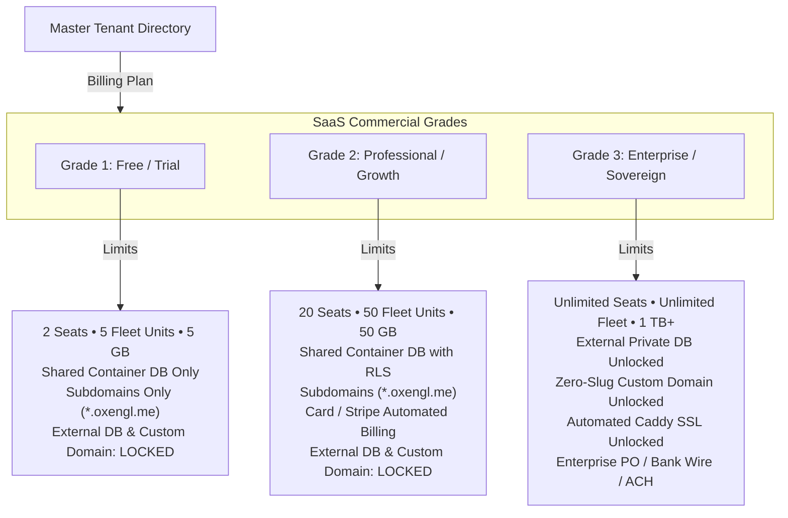
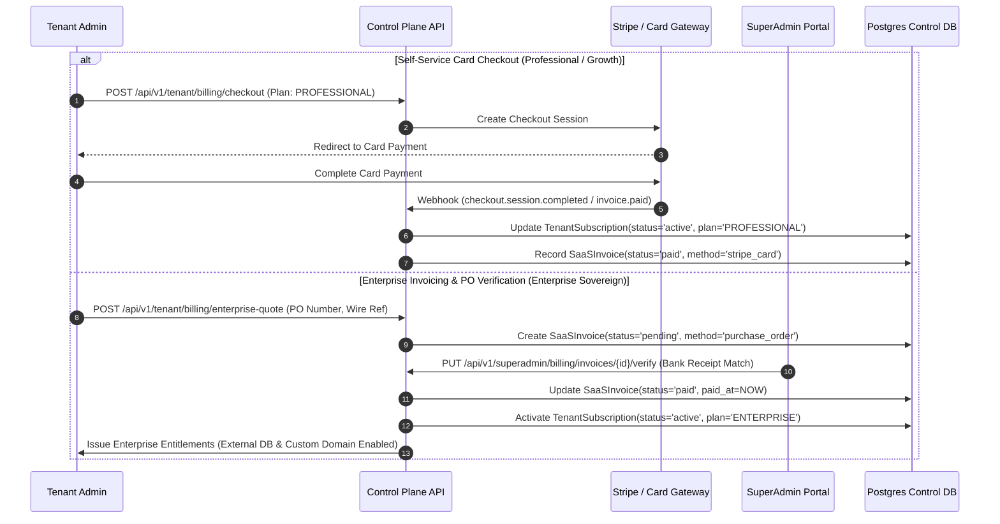
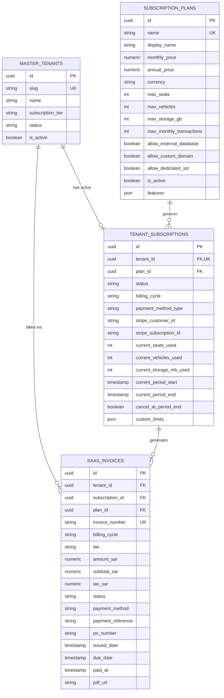

# OxenGl ERP — Multi-Grade SaaS Billing & Entitlements Specification

**Document Version:** 2.0.0  
**Status:** Approved Architecture Plan  
**Target:** Multi-Tenant Control Plane & Tenant Data-Plane  

---

## 1. Architectural Vision & Executive Summary

The OxenGl SaaS Billing and Entitlements Subsystem provides centralized subscription life-cycle management, automated multi-tier quota metering, enterprise invoice tracking, and entitlement gatekeeping across the entire ERP ecosystem.

Operating at Level 1 (Control Plane) within the `MasterTenant` directory and Level 2 (Tenant Data Plane), the billing system acts as the commercial boundary that determines:
1. **Infrastructure residency:** Whether a tenant resides on the shared multi-tenant database or is eligible for zero-downtime cutover to an **External Private Dedicated Database** (Phase 1 enterprise engine).
2. **Domain routing & TLS:** Whether a tenant is restricted to platform subdomains (`tenant.oxengl.me`) or can bind a **Zero-Slug Custom Domain** (`erp.customer.com`) with dynamic Caddy on-demand SSL (Phase 2 & 3 enterprise engine).
3. **Operational scale:** Quotas on active user seats, fleet units, storage volumes, and monthly ERP business transactions.

---

## 2. Multi-Grade SaaS Structure & Feature Entitlements

The subscription architecture categorizes all platform accounts into three distinct grades:



### Grade 1: Free / Trial Grade (Evaluation & Onboarding)
* **Tier Code:** `FREE`
* **Target Audience:** New business sign-ups, solo logistics brokers, small fleet evaluations, developer sandboxes.
* **Pricing:** 0 SAR / 0 USD per month (default 30-day evaluation or capped free tier).
* **Operational Limits & Quotas:**
  * **User Seats:** Maximum **2 active seats**.
  * **Fleet Units:** Maximum **5 vehicles**.
  * **Storage:** Maximum **5 GB** document/evidence storage.
  * **Monthly Operations:** Up to **100 business transactions/month** (e.g. POs, ledger entries).
* **Infrastructure & Domain Rules:**
  * **Database Residency:** Strictly forced onto the **Local Shared Container Database**. Any request to provision or migrate to an external database is rejected with `HTTP 403 Forbidden`.
  * **Domain Routing:** Restricted to platform subdomains (`slug.oxengl.me`). Custom domain configuration is locked.

### Grade 2: Professional / Growth Grade (Standard Business)
* **Tier Code:** `PROFESSIONAL`
* **Target Audience:** Active small-to-medium logistics providers, crushers, and regional fleet operators.
* **Pricing:** 185 SAR/month (~$49 USD) or 1,850 SAR/year (2 months free discount).
* **Operational Limits & Quotas:**
  * **User Seats:** Up to **20 active seats**.
  * **Fleet Units:** Up to **50 vehicles**.
  * **Storage:** Up to **50 GB** document storage.
  * **Monthly Operations:** Up to **10,000 transactions/month**.
* **Infrastructure & Domain Rules:**
  * **Database Residency:** Shared multi-tenant database with Row-Level Security (`app.current_company_id`) and optimized tenant-level indexing.
  * **Domain Routing:** Standard subdomains (`slug.oxengl.me`). Custom domain binding is locked.
  * **Billing Channels:** Automated recurring credit card charges via Stripe/Paddle with automated receipt generation and dunning retries.

### Grade 3: Enterprise / Sovereign Grade (High-Value Tier)
* **Tier Code:** `ENTERPRISE`
* **Target Audience:** Large multi-branch logistics networks, mining conglomerates, government contractors, sovereign compliance operations (e.g., `myon`).
* **Pricing:** 3,750 SAR/month (~$999 USD) or custom negotiated annual enterprise agreements ($10,000+ - $50,000+/year).
* **Operational Limits & Quotas:**
  * **User Seats:** **Unlimited** (`max_seats = 999999`).
  * **Fleet Units:** **Unlimited** (`max_vehicles = 999999`).
  * **Storage:** **1,000 GB (1 TB)** baseline, expandable.
  * **Monthly Operations:** **Unlimited**.
* **Enterprise Infrastructure & Branding Unlocks:**
  * **External Private Database Hosting:** Full access to configure AWS RDS, Neon, Supabase, or on-premise PostgreSQL instances, with the **6-stage live migration engine** and AES-256 DSN encryption.
  * **Zero-Slug Custom Domain Routing:** Full access to map enterprise domains (`erp.client.com`, `fleet.corp.sa`) directly via the `HostHeaderMiddleware`.
  * **Automated Dynamic SSL Provisioning:** Instant Let's Encrypt certificate issuance via Caddy reverse proxy on-demand TLS and authoritative DNS pre-flight verification.
  * **Enterprise Payment Rail:** Support for formal **Purchase Orders (POs)**, Net-30/Net-60 corporate invoicing, and offline Wire Transfer / ACH verification by platform SuperAdmins.

---

## 3. Payment Methods & Processing Architecture

The billing subsystem supports a dual-channel payment framework:



### Channel A: Automated Tokenized Card Payments (Stripe / Paddle)
* Used for instant self-serve checkout, monthly/annual recurring renewals, and automated seat upgrades.
* Webhook event listeners handle:
  * `customer.subscription.created` & `customer.subscription.updated`
  * `customer.subscription.deleted` (downgrades tenant to `FREE` or marks `canceled`)
  * `invoice.payment_succeeded` (records a paid `SaaSInvoice`)
  * `invoice.payment_failed` (marks subscription `past_due`, starts a 14-day grace period)

### Channel B: Enterprise Invoicing & Corporate Purchase Orders (PO / Bank Wire)
* Used for sovereign clients, government departments, and large enterprises that cannot use credit cards.
* Generates formal PDF invoices with VAT/ZATCA-compliant metadata, corporate IBAN/SWIFT instructions, and Net-30 terms.
* SuperAdmin control panel provides one-click manual verification (`mark_paid_via_wire`) that atomically records bank transaction IDs and updates tenant subscription validity.

### Channel C: Regional Gateway Hooks (PayTabs / HyperPay)
* Pluggable abstraction layer for regional Saudi / GCC payment rails (Mada, Apple Pay, Sadad).

---

## 4. Control Plane Database Architecture

The billing subsystem is implemented on the centralized Control Plane database with three core tables:



### Table 1: `subscription_plans`
Defines available commercial offerings, resource quotas, and architectural unlock flags.

| Column | Type | Constraints | Description |
| :--- | :--- | :--- | :--- |
| `id` | UUID | PRIMARY KEY | Unique plan identifier |
| `name` | VARCHAR(50) | UNIQUE, NOT NULL | Plan code (`FREE`, `PROFESSIONAL`, `ENTERPRISE`) |
| `display_name` | VARCHAR(100) | NOT NULL | Human-readable name |
| `description` | TEXT | NULLABLE | Marketing and feature summary |
| `monthly_price` | NUMERIC(10, 2) | NOT NULL | Monthly recurring price (SAR) |
| `annual_price` | NUMERIC(10, 2) | NOT NULL | Annual upfront price with discount (SAR) |
| `currency` | VARCHAR(10) | NOT NULL, DEFAULT 'SAR' | Currency code |
| `stripe_price_id` | VARCHAR(255) | NULLABLE | Associated Stripe Price ID |
| `stripe_product_id` | VARCHAR(255) | NULLABLE | Associated Stripe Product ID |
| `max_seats` | INTEGER | NOT NULL | Seat quota (-1 or 999999 for unlimited) |
| `max_vehicles` | INTEGER | NOT NULL | Fleet unit quota (-1 or 999999 for unlimited) |
| `max_storage_gb` | INTEGER | NOT NULL | Storage allowance in GB |
| `max_monthly_transactions` | INTEGER | NOT NULL | Monthly transaction cap (-1 for unlimited) |
| `allow_external_database` | BOOLEAN | NOT NULL, DEFAULT FALSE | **Phase 1 unlock flag** |
| `allow_custom_domain` | BOOLEAN | NOT NULL, DEFAULT FALSE | **Phase 2 unlock flag** |
| `allow_dedicated_ssl` | BOOLEAN | NOT NULL, DEFAULT FALSE | **Phase 3 unlock flag** |
| `features` | JSONB / JSON | NOT NULL, DEFAULT '[]' | List of enabled feature keys |
| `is_active` | BOOLEAN | NOT NULL, DEFAULT TRUE | Available for new subscriptions |
| `created_at` | TIMESTAMPTZ | NOT NULL, DEFAULT NOW() | Record creation timestamp |
| `updated_at` | TIMESTAMPTZ | NOT NULL, DEFAULT NOW() | Record update timestamp |

### Table 2: `tenant_subscriptions`
Tracks an active commercial contract for a tenant, including billing cycle, state, and live quota meters.

| Column | Type | Constraints | Description |
| :--- | :--- | :--- | :--- |
| `id` | UUID | PRIMARY KEY | Unique subscription record identifier |
| `tenant_id` | UUID | UNIQUE, NOT NULL, FK(`master_tenants.id`) | Tenant owning this contract |
| `plan_id` | UUID | NOT NULL, FK(`subscription_plans.id`) | Current active plan |
| `status` | VARCHAR(50) | NOT NULL, DEFAULT 'active' | `trialing`, `active`, `past_due`, `canceled`, `grace_period` |
| `billing_cycle` | VARCHAR(32) | NOT NULL, DEFAULT 'monthly' | `monthly`, `annual`, `quarterly`, `contract` |
| `payment_method_type` | VARCHAR(64) | NOT NULL, DEFAULT 'card' | `card`, `stripe`, `bank_transfer`, `purchase_order` |
| `stripe_customer_id` | VARCHAR(255) | NULLABLE, INDEX | Stripe customer ID for card billing |
| `stripe_subscription_id` | VARCHAR(255) | NULLABLE, INDEX | Active Stripe subscription object ID |
| `current_seats_used` | INTEGER | NOT NULL, DEFAULT 1 | Live count of provisioned user accounts |
| `current_vehicles_used` | INTEGER | NOT NULL, DEFAULT 0 | Live count of registered fleet vehicles |
| `current_storage_mb_used`| INTEGER | NOT NULL, DEFAULT 0 | Live storage consumption in MB |
| `current_period_start` | TIMESTAMPTZ | NOT NULL, DEFAULT NOW() | Cycle start date |
| `current_period_end` | TIMESTAMPTZ | NOT NULL | Cycle renewal date |
| `cancel_at_period_end` | BOOLEAN | NOT NULL, DEFAULT FALSE | Whether plan cancels upon period end |
| `canceled_at` | TIMESTAMPTZ | NULLABLE | Timestamp of cancellation request |
| `trial_ends_at` | TIMESTAMPTZ | NULLABLE | Expiry timestamp if in trial |
| `custom_limits` | JSONB / JSON | NULLABLE | Overrides for specific contract amendments |
| `notes` | TEXT | NULLABLE | Internal billing notes or contract terms |
| `created_at` | TIMESTAMPTZ | NOT NULL, DEFAULT NOW() | Creation timestamp |
| `updated_at` | TIMESTAMPTZ | NOT NULL, DEFAULT NOW() | Update timestamp |

### Table 3: `saas_invoices`
Stores billing records, tax calculations, payment references, and PDF download links.

| Column | Type | Constraints | Description |
| :--- | :--- | :--- | :--- |
| `id` | UUID | PRIMARY KEY | Unique invoice identifier |
| `tenant_id` | UUID | NOT NULL, FK(`master_tenants.id`) | Tenant billed |
| `subscription_id` | UUID | NULLABLE, FK(`tenant_subscriptions.id`) | Associated subscription record |
| `plan_id` | UUID | NULLABLE, FK(`subscription_plans.id`) | Plan billed |
| `invoice_number` | VARCHAR(64) | UNIQUE, NOT NULL, INDEX | Sequential number (`SAAS-INV-202609-001`) |
| `billing_cycle` | VARCHAR(32) | NOT NULL, DEFAULT 'monthly' | `monthly`, `annual`, `quarterly` |
| `tier` | VARCHAR(32) | NOT NULL, DEFAULT 'standard' | Plan tier representation |
| `amount_sar` | NUMERIC(18, 4)| NOT NULL, DEFAULT 0 | Total invoice amount in SAR |
| `subtotal_sar` | NUMERIC(18, 4)| NOT NULL, DEFAULT 0 | Subtotal before taxes |
| `tax_sar` | NUMERIC(18, 4)| NOT NULL, DEFAULT 0 | VAT (15% ZATCA standard) |
| `currency` | VARCHAR(10) | NOT NULL, DEFAULT 'SAR' | Currency |
| `status` | VARCHAR(32) | NOT NULL, DEFAULT 'paid' | `paid`, `pending`, `overdue`, `cancelled` |
| `payment_method` | VARCHAR(64) | NOT NULL, DEFAULT 'stripe_card' | `stripe_card`, `bank_transfer`, `purchase_order` |
| `payment_reference` | VARCHAR(255) | NULLABLE | Stripe charge ID or Bank transaction ID |
| `po_number` | VARCHAR(100) | NULLABLE | Customer purchase order reference |
| `issued_date` | TIMESTAMPTZ | NOT NULL, DEFAULT NOW() | Issuance timestamp |
| `due_date` | TIMESTAMPTZ | NULLABLE | Due date (typically +14 or +30 days) |
| `paid_at` | TIMESTAMPTZ | NULLABLE | Timestamp payment was confirmed |
| `pdf_url` | VARCHAR(255) | NULLABLE | Download link for PDF invoice |
| `notes` | TEXT | NULLABLE | Invoicing notes or wire instructions |
| `created_at` | TIMESTAMPTZ | NOT NULL, DEFAULT NOW() | Creation timestamp |
| `updated_at` | TIMESTAMPTZ | NOT NULL, DEFAULT NOW() | Update timestamp |

---

## 5. Seed Data for 3-Tier Multi-Grade Model

On application startup, the platform ensures these three default plans are seeded and synchronized in the `subscription_plans` table:

```json
[
  {
    "name": "FREE",
    "display_name": "Free Evaluation Tier",
    "description": "Exploratory sandbox for small operators and new evaluations.",
    "monthly_price": 0.00,
    "annual_price": 0.00,
    "currency": "SAR",
    "stripe_price_id": "price_free_tier",
    "max_seats": 2,
    "max_vehicles": 5,
    "max_storage_gb": 5,
    "max_monthly_transactions": 100,
    "allow_external_database": false,
    "allow_custom_domain": false,
    "allow_dedicated_ssl": false,
    "features": ["core_erp", "basic_reporting", "shared_db"]
  },
  {
    "name": "PROFESSIONAL",
    "display_name": "Professional Business Grade",
    "description": "Standard business operations for growing logistics & industrial firms.",
    "monthly_price": 185.00,
    "annual_price": 1850.00,
    "currency": "SAR",
    "stripe_price_id": "price_professional_monthly",
    "max_seats": 20,
    "max_vehicles": 50,
    "max_storage_gb": 50,
    "max_monthly_transactions": 10000,
    "allow_external_database": false,
    "allow_custom_domain": false,
    "allow_dedicated_ssl": false,
    "features": ["core_erp", "advanced_reporting", "shared_db", "automated_invoicing", "audit_trail"]
  },
  {
    "name": "ENTERPRISE",
    "display_name": "Enterprise Sovereign Grade",
    "description": "Dedicated infrastructure, sovereign data compliance, and private custom domain routing.",
    "monthly_price": 3750.00,
    "annual_price": 37500.00,
    "currency": "SAR",
    "stripe_price_id": "price_enterprise_custom",
    "max_seats": 999999,
    "max_vehicles": 999999,
    "max_storage_gb": 1000,
    "max_monthly_transactions": 999999,
    "allow_external_database": true,
    "allow_custom_domain": true,
    "allow_dedicated_ssl": true,
    "features": [
      "core_erp", "advanced_reporting", "external_private_db", "live_db_migration",
      "zero_slug_custom_domain", "automated_ssl_caddy", "priority_sla", "custom_zatca"
    ]
  }
]
```

---

## 6. Phased Implementation Roadmap

* **Phase 1: Billing & Subscription Data Models & Default Plan Seeds (CURRENT PHASE)**
  * Upgrade `SubscriptionPlan`, `TenantSubscription`, and `SaaSInvoice` models in the control plane.
  * Connect relationships to `MasterTenant` and ensure backwards compatibility with legacy tests.
  * Implement safe schema self-healing (`ALTER TABLE ADD COLUMN IF NOT EXISTS`) on PostgreSQL.
  * Implement automated startup seed data for the 3-tier plans (`FREE`, `PROFESSIONAL`, `ENTERPRISE`).
  * Add unit and integration tests verifying schema, relationships, and seed integrity.
* **Phase 2: Subscription Management Endpoints & Multi-Channel Invoicing**
  * Tenant billing endpoints: view current subscription, plan catalog, quota utilization meters.
  * Stripe Checkout Session creation & webhook listener expansion.
  * Enterprise manual PO creation and SuperAdmin wire transfer approval endpoints.
* **Phase 3: Entitlement Middleware & Architectural Feature-Gating**
  * Intercept external database configuration/migration endpoints (`/api/v1/tenant/control/database/*`) to enforce `allow_external_database`.
  * Intercept custom domain mapping endpoints (`/api/v1/tenant/control/domains/*`) to enforce `allow_custom_domain`.
  * Return descriptive `HTTP 403 Forbidden` with upgrade prompts for non-enterprise tenants.
* **Phase 4: End-to-End Validation & Comprehensive Integration Testing**
  * Automated adversarial tests for quota bypass, downgrade state machines, webhook replays, and enterprise tier unlocks.