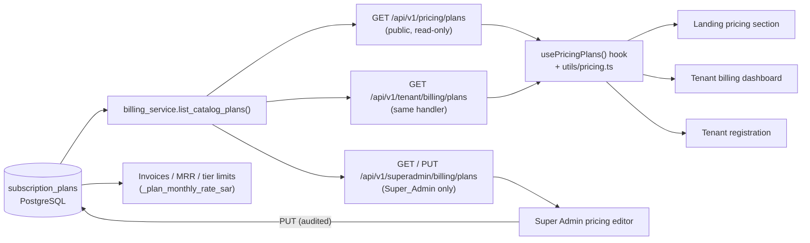

# Billing Unification — Single Pricing Source of Truth

**Date:** 2026-10-04
**Status:** Implemented and deployed (backend image `oxen-gl_backend:pricing`, frontend image `oxen-gl_frontend:pricing`)
**Commits:** `29a9e99` (backend), `a31087d` (frontend)
**Related:** [`billing_architecture_spec.md`](../billing_architecture_spec.md) (original tier design), [`security-architecture.md`](security-architecture.md)

---

## 1. Problem

Before this change, subscription prices were hard-coded separately in several places, and the values did not match:

| Surface | What it showed |
|---|---|
| Public landing page (`PricingSection.tsx`) | Static tiers, including 3,750 and 8,900 SAR |
| Super Admin console (`PlatformModules.tsx` → *Pricing & Subscription Plans*) | Static tiers of 2,500 / 6,500 / 14,000 SAR |
| Tenant billing dashboard (`TenantBillingView.tsx`) | Its own static cards and a hard-coded PO/VAT subtotal |
| Tenant registration (`TenantRegistrationView.tsx`) | Hard-coded "SAR 4,999 / year" |
| Backend `TIER_LIMITS` / `/api/master/subscriptions/plans` | A legacy 4-tier price list used for invoices and MRR |

The `subscription_plans` table already existed, but nothing in the UI read from it. Its startup seeder also **overwrote prices on every restart**. No UI let the platform owner change prices.

## 2. Solution overview

Every price shown or billed now comes from the `subscription_plans` table.

## 3. Data model — `subscription_plans`

`SubscriptionPlan` (`backend/app/domains/saas/models.py`) gained three presentation columns:

| Column | Type | Purpose |
|---|---|---|
| `display_features` | JSON (list of strings) | Marketing feature bullets shown on every pricing card |
| `is_featured` | boolean | Highlights a single "recommended" plan; only one plan can have it |
| `sort_order` | integer | Display order (FREE 10, PROFESSIONAL 20, ENTERPRISE 30) |

Migration:
- SQL: `backend/scripts/sql/2026-10-04_subscription_plan_catalog.sql` (already applied in production; the table was backed up first under `~/.oxengl/backups/pre_pricing_*_subscription_plans.sql`).
- Safety net: `main.py` runs `ALTER TABLE ... ADD COLUMN IF NOT EXISTS` for the same columns at startup.

### Seeding behaviour change

`seed_default_subscription_plans` is now **insert-only**:
- It creates missing tiers.
- It back-fills `display_features` once, and only if they are empty (from `DEFAULT_PLAN_PRESENTATION`).
- It **never overwrites existing prices**, so edits made by the Super Admin survive restarts and redeploys.

### Canonical catalog at go-live

| Plan | Monthly (SAR, excl. VAT) | Annual (SAR, excl. VAT) | Featured |
|---|---|---|---|
| FREE | 0 | 0 | — |
| PROFESSIONAL | 185 | 1,850 | ✓ |
| ENTERPRISE | 3,750 | 37,500 | — |

These match the tiers in `billing_architecture_spec.md`. From now on, the Super Admin editor is where prices are changed.

## 4. API surface

| Method & path | Auth | Description |
|---|---|---|
| `GET /api/v1/pricing/plans` (alias `/api/pricing/plans`) | Public | Active plans ordered by `sort_order`. Stripe IDs are stripped (`_public_plan_dict`). |
| `GET /api/v1/tenant/billing/plans` | Tenant | Same handler and payload as the public endpoint. |
| `GET /api/v1/superadmin/billing/plans` | Super_Admin | All plans, including inactive ones, plus `subscriber_count`. |
| `PUT /api/v1/superadmin/billing/plans/{id}` | Super_Admin | Partial update (see validation below). |
| `GET /api/master/subscriptions/plans` | — | Legacy shape kept for compatibility, now **read from the DB**. |

`PUT` validation (`SubscriptionPlanUpdateRequest`):
- Prices are `Decimal` values, sent as strings, and cannot be negative.
- `display_features` allows at most 20 items of at most 160 characters each. An empty list is rejected (400).
- Quota limits are bounded (`max_seats`, `max_vehicles`, `max_storage_gb`, `max_monthly_transactions`).
- Setting `is_featured = true` clears the flag on every other plan.
- Every successful edit writes a `PRICING_PLAN_UPDATED` entry to the platform audit log (`record_platform_audit`).

### Backend consumers moved to the DB

- `TIER_LIMITS` in `main.py` now holds **quotas only**. Its price keys were removed.
- The new helper `_plan_monthly_rate_sar(db, tier)` supplies the monthly rate for:
  - the billing summary / MRR;
  - the auto-invoice fallback;
  - `PUT /api/master/tenants/{id}/subscription`, which also takes its seat and storage limits from the DB plan.

## 5. Frontend changes — hard-coded prices removed

Shared building blocks:
- `frontend/src/hooks/usePricingPlans.ts`: fetches `/api/v1/pricing/plans` once and caches it at module level. Call `invalidatePricingPlans()` after an admin edit.
- `frontend/src/utils/pricing.ts`: `formatSar`, `annualSavingsPercent` / `annualSavingsLabel`, `annualMonthlyEquivalent`, `isUnlimited` (≥ 999,999), `isFreePlan`, `sortPlans`, `normalizeTierCode` (mirrors the backend tier aliases), and `VAT_RATE = 0.15`.
- `services/api.ts`:
  - `getPricingPlans` and `getSubscriptionPlans` both call the unified endpoint;
  - new `getAdminPricingPlans` and `updatePricingPlan` for the admin editor.

| View | Before | After |
|---|---|---|
| Landing `PricingSection.tsx` | Static tier array | Built from the API, with a monthly/annual toggle, annual "≈ x / month", loading skeleton and error state. Element IDs: `pricing-plan-*`, `pricing-select-*` |
| Tenant `TenantBillingView.tsx` | 3 static cards + fixed PO amounts | Mapped plan grid (`tenant-plan-*`), computed savings badge, PO modal subtotal / VAT 15% / total taken from the ENTERPRISE plan |
| `TenantRegistrationView.tsx` | "SAR 4,999 / year" | ENTERPRISE `annual_price` from the hook |
| Super Admin cockpit (`PlatformModules.tsx`) | MRR from static prices; "Manage Plan" select had a fixed list | MRR and the plan select both come from the catalog |

We checked the production bundle: no subscription-tier price literals remain (3,750 / 8,900 / 14,000 / 4,999 do not appear anywhere).

## 6. Super Admin pricing editor

Location: **Master Console → Pricing & Subscription Plans** (`PricingPlansView` in `frontend/src/components/platform/PlatformModules.tsx`).

- One card per plan, showing its prices, featured/active state and subscriber count.
- **Edit** (`admin-plan-edit-*`) opens a modal with these fields:
  - display name and description;
  - monthly and annual SAR prices;
  - feature bullets (one per line);
  - quota limits;
  - featured, active and sort order.
- **Save** (`plan-edit-save`) sends a `PUT` to `/api/v1/superadmin/billing/plans/{id}` and invalidates the shared pricing cache. The landing page, tenant dashboard and registration views show the new values on their next load.

## 7. Security guards added

Building this work turned up two authorization gaps, and both are fixed:

| Endpoint | Before | After |
|---|---|---|
| Entire `superadmin_billing_router` (`/api/v1/superadmin/billing/*`: summary, invoices, invoice verification, custom limits, plans) | **No authentication.** `/summary` and `/invoices` returned 200 with no token. | Router-level `dependencies=[Depends(require_super_admin)]`. Unauthenticated → 401, tenant admin → 403. |
| `PUT /api/master/tenants/{id}/subscription` | Any authenticated user could change any tenant's tier | Requires Super_Admin (403 otherwise). The tier must be a known alias (400 otherwise). Limits and invoice amount come from the DB plan. |

The public pricing endpoint is read-only and never exposes Stripe price or product IDs.

## 8. Verification (production, 2026-10-04)

| Check | Result |
|---|---|
| `GET /api/v1/pricing/plans` | 200 — FREE 0/0, PROFESSIONAL 185/1,850 (featured), ENTERPRISE 3,750/37,500; features back-filled (5/7/8); no Stripe fields |
| `GET /api/v1/tenant/billing/plans` | Identical payload |
| `GET /api/master/subscriptions/plans` | DB values |
| `/api/v1/superadmin/billing/{summary,invoices,plans}` with no token | 401 |
| Same endpoints as Myon tenant admin | 403 |
| Super Admin `GET` plans | 200, with subscriber counts |
| Super Admin `PUT` PROFESSIONAL 185 → 186 | 200 and shown on the public endpoint at once; **reverted to 185** |
| `PUT` with empty features / negative price | 400 / 422 |
| Tenant admin `PUT /api/master/tenants/{id}/subscription` | 403 |
| Live bundle | Landing chunk calls `/api/v1/pricing/plans`; no legacy tier prices |

## 9. Rollback

- Containers: `oxengl_backend_prev` (image `:secfix`) and `oxengl_frontend_prev` (image `:navy`) are kept stopped and can be swapped back.
- Database: the new columns are additive and the old images ignore them. The pre-change table dump is in `~/.oxengl/backups/`.

## 10. Known follow-ups (out of scope for this change)

- **`master_platform` router is unauthenticated.** For example, `GET /api/master/platform/tenants` returns 200 without a token. This is high priority.
- **Tenant invoice IDOR.** `/api/v1/tenant/billing/invoices/{id}` does not check that the invoice belongs to the caller's tenant.
- **Feature bullets are English-only.** The tenant dashboard previously had Arabic tier text; `display_features` would need a localized variant.
- **Dead code.** `OxenGLCloudPortal.tsx` still contains old hard-coded prices but is not imported anywhere. It can be deleted.
- **Free plan.** The "Downgrade to Free" button in the tenant dashboard has no action wired up. This predates this change.
