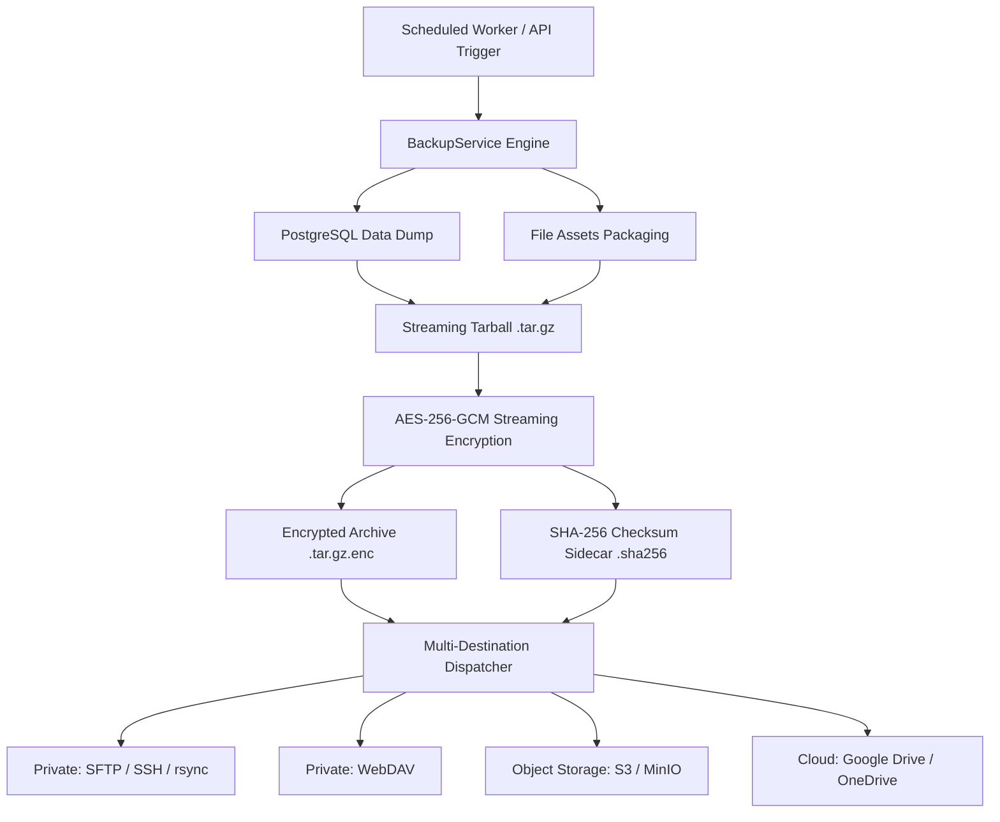
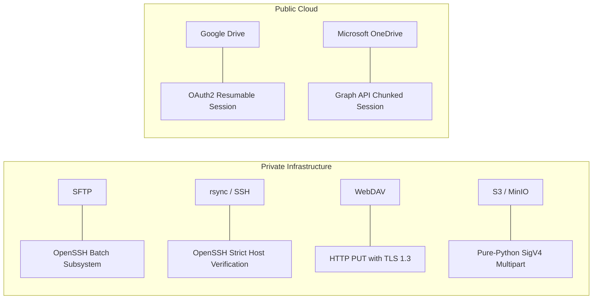
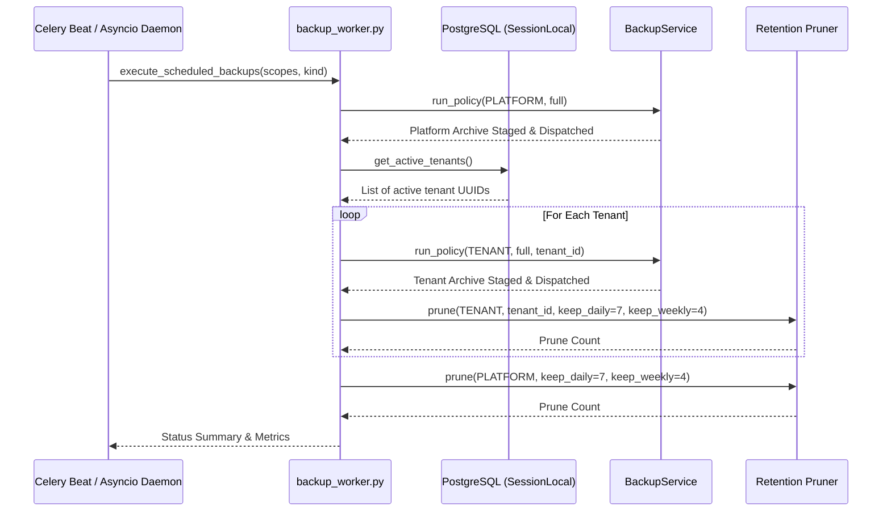

# OxenGL Enterprise Backup Service: Technical Architecture & Implementation Guide

## 1. Executive Summary & Overview

OxenGL implements an enterprise-grade, full-scope disaster recovery and backup service in [`backend/app/services/backup_service.py`](file:///home/ahmed_awadh/Oxen-gl/backend/app/services/backup_service.py) orchestrated by [`backend/app/services/backup_worker.py`](file:///home/ahmed_awadh/Oxen-gl/backend/app/services/backup_worker.py). The system guarantees complete point-in-time state capture across **both relational database state and physical file storage assets** with zero data loss, strict tenant boundary isolation, cryptographic confidentiality, and multi-destination dispatch.



---

## 2. Backup Scopes & Isolation Model

OxenGL distinguishes between two distinct operational backup scopes:

### 2.1 Platform Scope (`BackupScope.PLATFORM`)
- **Intent**: Comprehensive platform recovery, bare-metal re-hosting, and catastrophic hardware failover.
- **Relational Data**: Dumps the complete `erp_db` PostgreSQL database, including global roles, tablespaces, cluster configuration, public schema, and all tenant schemas (`pg_dumpall --globals-only` and `pg_dump -Fc`).
- **File Assets**: Packages all system media roots, uploads, attachments, invoices, and branding assets across all tenants and administrative domains.

### 2.2 Tenant Scope (`BackupScope.TENANT`)
- **Intent**: Isolated tenant workspace export, GDPR/ZATCA data portability, and tenant migration.
- **Relational Data**:
  - Schema-isolated tables: Dumps the tenant's dedicated PostgreSQL schema (e.g., `tenant_<slug>`).
  - Shared-table records: Exports tenant-owned rows from shared public tables (`res_companies`, `res_users`, `saas_invoices`, `tenant_audit_logs`) captured from a single consistent database snapshot (`pg_export_snapshot`).
- **File Assets**: Packages strictly the files owned by the target tenant (`OXENGL_LOGO_UPLOAD_DIR/logo_<tenant_id>_*`, `attachments/<tenant_id>/*`, `invoices/<tenant_id>/*`). All other tenant paths, device nodes, and symlinks are strictly excluded.

---

## 3. Archive Layout & Manifest Specification

Every backup produces two cryptographic artifacts:
1. **Encrypted Archive**: `oxengl-{scope}-{kind}-{YYYYmmddTHHMMSSZ}-{id8}.tar.gz.enc`
2. **Checksum Sidecar**: `oxengl-{scope}-{kind}-{YYYYmmddTHHMMSSZ}-{id8}.tar.gz.enc.sha256`

### 3.1 Inner Archive Directory Hierarchy (Pre-Encryption)
```
oxengl-archive/
├── database/
│   ├── schema.sql           # Schema DDL definitions
│   ├── data.dump            # PostgreSQL custom binary dump (-Fc)
│   ├── shared_rows.sql      # Extracted tenant rows from shared tables (Tenant scope)
│   └── globals.sql          # Cluster roles and globals (Platform scope)
├── files/
│   ├── logos/               # Custom brand logos and corporate seals
│   ├── media/               # Uploaded images, wallpapers, and banners
│   ├── attachments/         # Operational attachments (waybills, weighbridge tickets)
│   └── invoices/            # Generated PDF tax invoices and ZATCA compliance XMLs
└── manifest.json            # Final member: Canonical JSON metadata receipt
```

### 3.2 Canonical Manifest (`manifest.json`)
The manifest is serialized and injected as the final entry in the archive. It contains:
```json
{
  "format": "oxengl-backup",
  "format_version": 1,
  "archive_name": "oxengl-tenant-full-20261004T050000Z-a1b2c3d4.tar.gz.enc",
  "scope": "tenant",
  "kind": "full",
  "tenant_id": "f7b38b2f-5426-4625-a110-e38261fdf6e1",
  "created_at": "2026-10-04T05:00:00Z",
  "database": {
    "engine": "postgresql",
    "version": "15.0",
    "files": [
      {"path": "database/schema.sql", "size": 48201, "sha256": "e3b0c44..."},
      {"path": "database/data.dump", "size": 1840291, "sha256": "4a5b6c7..."}
    ]
  },
  "files": [
    {"path": "files/logos/logo_f7b38b2f_a1.png", "size": 24510, "sha256": "1f8b2c..."}
  ],
  "checksums": {
    "sha256_ciphertext": "9f83b2...",
    "sha256_plaintext_tar": "3a1c4e..."
  }
}
```

---

## 4. Cryptographic Envelope Engine (AES-256-GCM)

The backup archive is encrypted **in a streaming pipeline** as it is compressed to avoid disk bloat and memory exhaustion.

### 4.1 Envelope Header Specification (84 Bytes Binary)
The encrypted file begins with an 84-byte binary header followed by authenticated ciphertext chunks:

| Offset | Length | Field | Description |
|---|---|---|---|
| `0x00` | 8 bytes | `Magic Bytes` | ASCII string `OXENENC1` |
| `0x08` | 8 bytes | `Key Fingerprint` | Truncated SHA-256 fingerprint of the Master Key |
| `0x10` | 12 bytes | `DEK IV` | Nonce used to encrypt the Data Encryption Key |
| `0x1C` | 32 bytes | `Encrypted DEK` | Ephemeral AES-256 Data Encryption Key (encrypted via Master Key) |
| `0x3C` | 16 bytes | `DEK Tag` | AES-256-GCM authentication tag for wrapped DEK |
| `0x4C` | 4 bytes | `Chunk Size` | Big-endian 32-bit integer (default: 1,048,576 bytes / 1MB) |

### 4.2 Streaming Chunked Encryption & Integrity
- **DEK Generation**: An ephemeral 256-bit cryptographically secure random Data Encryption Key (DEK) is generated for each archive.
- **DEK Wrapping**: The DEK is encrypted using the system Master Key from `crypto_vault` via AES-256-GCM.
- **Chunk Segmentation**: Data is split into 1MB chunks. Each chunk receives a distinct 12-byte IV formatted as:
  $$\text{IV} = \text{Prefix (3 bytes)} \parallel \text{Counter (8 bytes, big-endian)} \parallel \text{Final Flag (1 byte)}$$
- **Additional Authenticated Data (AAD)**: The entire 84-byte envelope header is bound as AAD to every chunk. Any tampering with the header invalidates all chunk tags.
- **Anti-Truncation**: The `Final Flag` ensures that truncated files or dropped final blocks are immediately rejected with `BackupIntegrityError`.

---

## 5. Multi-Destination Transport Protocols

The backup service implements zero-leakage transport connectors dispatched in parallel or sequential policies:



### 5.1 Private Server Connectors
1. **SFTP / Secure Shell**:
   - Uses OpenSSH binaries (`sftp`, `ssh`, `rsync`) with strictly isolated identity files (`-i <key_file>`), dedicated ephemeral known-hosts directories, and credential sanitization.
   - Passwords and private keys are never exposed in command-line arguments (`argv`), logs, or audit records.
2. **WebDAV**:
   - Implements streaming HTTP `PUT` requests over TLS with Basic or Bearer token authentication.
   - Supports atomic target directory verification via `PROPFIND` / `MKCOL`.
3. **S3 / MinIO Private Storage**:
   - Implements native **Pure-Python AWS Signature Version 4 (SigV4)** signing over HTTPX without third-party `boto3` runtime bloat.
   - Automatically utilizes Multipart Upload for archives exceeding 8MB with concurrent chunk dispatch.

### 5.2 Cloud Connectors (OAuth2 Handlers)
1. **Google Drive Connector**:
   - Uses OAuth2 refresh-token exchange to generate short-lived bearer tokens.
   - Initiates resumable upload sessions (`uploadType=resumable`) with 256KB-aligned chunked transfer and MD5/SHA256 validation.
2. **Microsoft OneDrive Connector**:
   - Integrates with Microsoft Graph API `/me/drive/root:/...:/createUploadSession`.
   - Dispatches chunked byte ranges with exponential backoff on HTTP 429/503 rate limits.

---

## 6. Background Scheduling & Automation

Automated execution is driven by [`backend/app/services/backup_worker.py`](file:///home/ahmed_awadh/Oxen-gl/backend/app/services/backup_worker.py) via two complementary execution engines:



### 6.1 Grandfather-Father-Son (GFS) Retention Policy
The pruner parses standard archive naming timestamps and groups snapshots:
- **Daily Snapshots**: Retains the latest backup of each calendar day for the past `OXENGL_BACKUP_KEEP_DAILY` days (default: 7 days).
- **Weekly Snapshots**: Retains the Sunday full snapshot for the past `OXENGL_BACKUP_KEEP_WEEKLY` weeks (default: 4 weeks).
- Older or non-conforming archives are safely unlinked from local staging and purged across remote destinations.

### 6.2 Execution Methods
- **Celery Beat**: Task `tasks.execute_scheduled_backups` scheduled daily at `02:00 UTC` and weekly on Sunday at `03:00 UTC`.
- **Asyncio Daemon**: `BackupWorkerDaemon` integrated into FastAPI lifespan, evaluating cron trigger conditions every 60 seconds.
- **CLI Runner**:
  ```bash
  # Run immediate platform + tenant backup
  python3 -m backend.app.services.backup_worker --now

  # Run tenant-only incremental backup
  python3 -m backend.app.services.backup_worker --now --scope=tenants --kind=incremental

  # Start long-running supervisor daemon
  python3 -m backend.app.services.backup_worker --daemon
  ```

---

## 7. Disaster Recovery & Restoration Procedures

### 7.1 Archive Verification & Decryption
```python
from backend.app.services.backup_service import BackupService
from pathlib import Path

service = BackupService()

# Verify integrity and decrypt to extraction directory
manifest = service.verify_archive(
    archive_path=Path("/var/backups/oxengl/staging/oxengl-platform-full-20261004T050000Z-a1b2c3d4.tar.gz.enc"),
    extract_to=Path("/tmp/restore_workspace"),
)
print("Verified Manifest:", manifest["format_version"], manifest["scope"])
```

### 7.2 Database Restoration
```bash
# 1. Platform Database Restore (PostgreSQL)
pg_restore -U postgres -d erp_db --clean --if-exists /tmp/restore_workspace/database/data.dump

# 2. Tenant Isolated Schema Restore
psql -U postgres -d erp_db -f /tmp/restore_workspace/database/schema.sql
```

### 7.3 File Assets Re-attachment
The service automatically maps unpacked file assets back to their configured media paths with strict path traversal checks:
- Rejects archive members containing `..` or absolute leading slashes.
- Restores file timestamps (`mtime`) and validates every restored asset against the manifest's SHA-256 hash.
